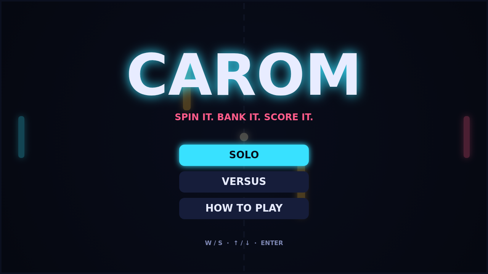

# Carom

Carom is a top-down paddle duel played on a dark, glowing field. Two paddles face each other across a dashed net, a ball ricochets between them, and a pair of fixed amber bars in the middle of the field turn every rally into a small bank-shot puzzle. Play Solo against a quick computer opponent, or share the keyboard with a friend in Versus.

A match opens with a one-second countdown and a gentle serve. The first rallies are slow and readable: the ball leaves at a modest speed, and every paddle hit nudges it a little faster. By the middle of the match the ball is streaking across the field, and a rally that started as a polite exchange has become a scramble. Win by reaching eleven points with a two-point lead, so a 10-10 tie keeps going until someone breaks away.

The paddle is not just a wall. Where the ball meets it decides the angle, and how the paddle is moving at that instant decides the curve. Strike the ball while sliding down and it bends clockwise; strike it while sliding up and it bends the other way. The spin fades over a second or so, but a well-timed hit can swing the ball around an obstacle and into the open corner your opponent just left.

Use the walls and the bars on purpose. A flat return can be banked off a bar to arrive from an angle nobody expects, and a curving ball carries that spin through every bounce. The ball's fading trail shows exactly how it just travelled, which makes the curve easy to read, and easier to copy.
